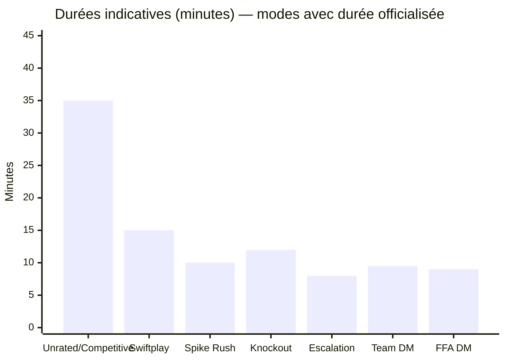

# Tous les modes de jeu listés dans VALORANT : rapport analytique et comparatif

## Résumé exécutif

Ce rapport couvre les modes demandés (Unrated, Competitive, Knockout, Skirmish 2v2, Swiftplay, Deathmatch, Team Deathmatch, Spike Rush, Escalation, Premier, Custom) avec une grille homogène : objectif, règles de victoire, gestion des éliminations/réapparitions, économie/arsenal/capacités, durées typiques, contraintes de matchmaking/rang, fin de partie, cartes, limites en parties personnalisées et différences clés.

À date de rédaction (**21 mars 2026**), il faut distinguer trois familles de modes :  
- Les modes « Spike » à manches et économie (Unrated, Competitive, Swiftplay, Premier) où l’objectif principal est le **plant/defuse** et où l’équipement se gère via une phase d’achats. Ces modes tendent à produire les matchs les plus longs (≈ 30–40 min pour un match complet standard) et structurent l’expérience tactique « core » de VALORANT.[^spikerush_support]  
- Les modes « respawn » (Deathmatch, Team Deathmatch, Escalation) conçus pour l’entraînement mécanique, les répétitions rapides et la variété d’armes : durée courte et règles simplifiées (souvent sans économie), réapparitions fréquentes.[^dm_support][^tdm_101][^escalation_article]  
- Les modes temporaires/rotationnels (ici Knockout et Skirmish 2v2) qui explorent des hypothèses de design (résurrection par kill, mini-arènes 2v2 « gunplay-only ») et **peuvent entrer/sortir des files** pour éviter de diluer les files d’attente (un point déjà expliqué par Riot lorsqu’ils ont instauré la rotation des modes « casual »).[^modes_rotation][^patch_1203][^patch_1205]

Point d’attention important : **Skirmish : 2v2 a été ajouté en file en 12.03 (17 févr. 2026) puis retiré en 12.05 (17 mars 2026)**, tandis que **Knockout** est le mode temporaire mis en avant en 12.05.[^patch_1203][^patch_1205]

## Cadre de référence commun

Dans VALORANT, la plupart des modes se lisent via quatre axes :  
1) **Objectif de victoire** (manches « Spike », kills, progression de niveaux, élimination tactique).  
2) **Gestion de la mort** : pas de respawn intra-manche (modes Spike classiques), respawn continu (Deathmatch/TDM/Escalation), ou mécanisme hybride (résurrection conditionnelle dans Knockout).[^tdm_101][^dm_support][^patch_1205]  
3) **Économie et arsenal** : économie classique à crédits (Unrated/Competitive/Premier) vs économie « compressée » (Swiftplay) vs pas d’économie (TDM/Escalation/Skirmish 2v2/Knockout/Spike Rush).[^swiftplay_512][^tdm_101][^patch_1203][^patch_1205][^spikerush_support]  
4) **Disponibilité des cartes** : cartes « Spike » (pool variable par patch), cartes dédiées TDM, cartes Skirmish A/B/C.[^patch_1205][^tdm_101][^patch_712][^patch_908][^patch_1203]

## Tableau comparatif récapitulatif

Le tableau ci-dessous synthétise les propriétés les plus discriminantes. Les durées sont indiquées **telles que documentées** lorsqu’une source officielle les donne (ou sous forme de fourchette), sinon « variable ».

| Mode | Joueurs min/max | Durée moyenne | Victoires requises | Respawn (intra-manche) | Économie | Restrictions de rang / accès | Cartes jouables (principe) |
|---|---:|---:|---|---|---|---|---|
| Unrated | 10 (5v5) | ≈ 30–40 min | 13 manches | Non | Oui | Aucune restriction de rang (MMR non affiché) | Cartes Spike (pool variable) |
| Competitive | 10 (5v5) | ≈ 30–40+ min | 13 manches (+ overtime) | Non | Oui | Niveau de compte requis + règles de groupe + règles Immortel+; MFA requise en UE pour Ascendant+ (depuis 12.01) | Pool compétitif (variable; 12.05 : Lotus/Fracture IN, Abyss/Corrode OUT) |
| Knockout | 10 (5v5) | 8–15 min | 4 manches | « Oui » via résurrection conditionnelle | Non | Aucune | Cartes TDM |
| Skirmish (2v2) | 4 (2v2) | Variable (pas de timer de round public) | 10 manches | Non | Non (choix d’armes free) | Aucune | Skirmish A/B/C (aléatoire) |
| Swiftplay | 10 (5v5) | ≈ 15 min | 5 manches | Non | Oui (économie accélérée) | Aucune | Cartes Spike (pool variable) |
| Deathmatch (FFA) | Jusqu’à 14 | 6–9 min (limite 9) | 40 kills ou temps | Oui | Non (argent infini) | Aucune | Cartes « standard » adaptées au DM (pool variable) |
| Team Deathmatch | 10 (5v5) | 9 min 30 | 100 kills ou avance au temps | Oui (≈ 1,5 s) | Non | Aucune | Cartes TDM dédiées (Piazza/District/Kasbah + Drift + Glitch) |
| Spike Rush | 10 (5v5) | 8–12 min | 4 manches (Bo7) | Non | Non | Aucune | Cartes Spike (pool variable) |
| Escalation | 10 (5v5) | ≈ 7–9 min | Niveau 12 ou avance à 10 min | Oui | Non | Aucune | Cartes « standard » (pool variable) |
| Premier | 10 par match (équipes 5–7) | ≈ 30–40+ min | 13 manches (match) | Non | Oui | Éligibilité (SMS, placement classé, compte en règle…) + divisions | Cartes Spike (pool Premier/compétitif) |
| Custom | Variable | Variable | Variable | Variable | Variable | Aucune (pas de matchmaking) | Selon mode choisi; Skirmish A/B/C disponible en custom |

Sources officielles principales ayant servi à l’ossature du tableau : Spike Rush (durées et format), Deathmatch, TDM 101, Escalation, patchs 12.03/12.05 (Skirmish 2v2, Knockout) et FAQ Compétition (accès/restrictions).[^spikerush_support][^dm_support][^tdm_101][^escalation_article][^patch_1203][^patch_1205][^comp_faq_fr]

## Cartographie des modes et durées

```mermaid
flowchart TB
  A[Modes VALORANT] --> B[Spike / plant-defuse]
  A --> C[Respawn / entraînement]
  A --> D[Tournoi & équipe]
  A --> E[Temporaires / rotation]

  B --> B1[Unrated]
  B --> B2[Competitive]
  B --> B3[Swiftplay]
  B --> B4[Spike Rush\n(spike, mais sans économie)]

  C --> C1[Deathmatch (FFA)]
  C --> C2[Team Deathmatch]
  C --> C3[Escalation]

  D --> D1[Premier]
  D --> D2[Custom (Tournament Mode, etc.)]

  E --> E1[Knockout]
  E --> E2[Skirmish 2v2\n(entré 12.03, sorti 12.05)]
  D2 --> E3[Skirmish (custom)\n(11.07b)]
```



Lecture du graphique :  
- La valeur « Unrated/Competitive » est un **milieu de fourchette** (30–40 min) explicitement mentionnée comme durée d’un match standard dans l’article d’assistance Spike Rush.[^spikerush_support]  
- Knockout (8–15 min), Spike Rush (8–12 min), Escalation (7–9 min) et Team Deathmatch (9:30) sont donnés explicitement par Riot (patch notes ou articles officiels).[^patch_1205][^spikerush_support][^escalation_article][^tdm_101]  
- Deathmatch FFA a une condition de victoire à 40 kills et une limite à 9 min (donc la durée « moyenne » dépend du rythme; le graphe affiche la borne haute).[^dm_support]

## Fiches analytiques par mode

### Unrated (Non classé)

**Concept / objectif.** Mode « Spike » standard (plant/defuse) sans progression de rang visible : l’objectif est de gagner des manches via l’explosion du Spike, la désactivation, l’élimination adverse ou la gestion du temps.[^beginners_guide][^spike_timers]

**Règles détaillées.**  
- **Victoire de manche** : typiquement (i) Spike posé et protégé jusqu’à explosion, (ii) Spike désamorcé, (iii) élimination de l’équipe adverse, (iv) expiration du temps de manche empêchant l’objectif (logique plant/defuse).[^beginners_guide][^spike_timers]  
- **Éliminations / réapparitions** : pas de respawn pendant la manche ; retour au round suivant.[^beginners_guide]  
- **Économie** : phase de préparation au début du round permettant d’acheter armes/équipement/compétences selon ses crédits.[^beginners_guide]  
- **Armes & capacités** : arsenal complet, capacités d’agent utilisables (charges dépendantes du système de la partie).[^beginners_guide]  

**Durée typique.** Riot qualifie un match standard de l’ordre de **30–40 min**, ce qui sert de point de comparaison pour les modes rapides.[^spikerush_support] (La durée « par manche » varie fortement selon la vitesse de contact et la gestion du Spike.)

**Joueurs / équipes.** 5v5 (10 joueurs).

**Matchmaking / restrictions.** Pas de restrictions de rang; matchmaking basé sur un MMR non affiché (principe général).

**Fin de partie.** Première équipe à atteindre le seuil de manches (format standard) ou via reddition (voir plus bas).

**Cartes.** Cartes « Spike mode » (pool variable selon patch / région / rotation).

**Parties personnalisées.** Le format « Standard » (équivalent Spike) est sélectionnable en custom ; ses paramètres peuvent être modifiés via options de salon (ex. Tournament Mode, etc.).[^patch_1200][^patch_30]

**Différences notables.**  
- Par rapport à Competitive : absence de rang/RR, et les règles de reddition diffèrent (vote d’abandon moins strict en Unrated).[^surrender_fr]  

### Competitive (Compétition)

**Concept / objectif.** Même boucle tactique « Spike » que le mode standard, mais avec classement et contraintes destinées à protéger l’intégrité compétitive (accès, taille de groupe, etc.).[^comp_faq_fr]

**Règles détaillées.**  
- **Victoire / éliminations / économie** : identiques au mode Spike standard (buy phase + crédits; pas de respawn intra-manche).[^beginners_guide]  
- **Overtime** : en cas d’égalité en fin de match, la Compétition s’appuie sur un système de prolongation (overtime) plutôt qu’une simple manche décisive unique (différence classiquement admise entre Unrated et Competitive).[^comp_wiki]

**Durée typique.** Comparable au match standard (≈ 30–40 min), avec possibilité d’allongement via overtime.[^spikerush_support][^comp_wiki]

**Joueurs / équipes.** 5v5.

**Restrictions de rang / matchmaking.**  
- **Accès** : niveau de compte minimum requis pour accéder à la file Compétition.[^comp_faq_en]  
- **Restrictions de groupe** : règles de disparité de rang pour duo/trio, interdiction des groupes de 4, règles spécifiques pour Immortel+ (solo/duo/5-stack), et pénalités potentielles de RR pour certains 5-stacks très hétérogènes.[^comp_faq_fr]  
- **Authentification multi-facteurs (UE)** : Riot annonce qu’à partir du patch 12.01, en Europe, les comptes détectés comme partagés et tous les joueurs Ascendant+ doivent activer la MFA Riot Mobile pour accéder à Competitive; les autres modes ne sont pas affectés.[^patch_1200]

**Fin de partie.** Score cible atteint + overtime si nécessaire; reddition possible (vote unanime en Compétition d’après l’article support).[^surrender_fr]

**Cartes.** Pool compétitif changeant. Exemple récent : patch 12.05 (17 mars 2026) : **Lotus et Fracture IN**, **Abyss et Corrode OUT** (pour Competitive et Deathmatch).[^patch_1205]

**Parties personnalisées.** Pas de « Competitive » au sens classé, mais les customs en **Tournament Mode** peuvent reproduire des règles proches (timeouts, rollback, coach slots, etc.).[^patch_904][^patch_208][^patch_30]

**Différences notables.**  
- Par rapport à Unrated : contraintes de groupe, accès niveau de compte, potentiel MFA (selon rang/état du compte), et impact direct sur le classement.[^comp_faq_fr][^patch_1200]

### Knockout

**Concept / objectif.** Mode temporaire tactique « élimination à rounds » : l’équipe doit gagner des manches en **éliminant tous les ennemis**, avec une mécanique centrale de **résurrection** : chaque élimination d’un ennemi ramène un coéquipier tombé.[^patch_1205]

**Règles détaillées.**  
- **Victoire de manche** : éliminer tous les ennemis (« wipe »).[^patch_1205]  
- **Réapparitions / résurrections** : « résurrection par kill » (délai croissant en fonction de l’avancée du round). En overtime, les respawns et le soin sont désactivés et un dégât sur la durée force un affrontement final.[^patch_1205]  
- **Économie** : aucune ; on sélectionne son équipement, et les offres d’armes montent en puissance par « stages » au fil du match.[^patch_1205]  
- **Armes & capacités** : sélection d’agent standard avec des vitesses de recharge d’aptitudes calquées sur Team Deathmatch; ultime gagné via kills ou captures d’orbes, mais la charge d’ultime est réinitialisée à la mort et au début de chaque round.[^patch_1205][^tdm_101]  
- **Contrôle de territoire** : une ligne centrale sépare les territoires; des orbes capturables déplacent la ligne (et soignent + donnent une charge d’ultime), tandis qu’entrer en territoire ennemi applique un debuff (« Threat Detected », minimap perturbée) encourageant des pushes coordonnés.[^patch_1205]

**Durées.** Rounds de **3 minutes**; match complet **8–15 minutes**.[^patch_1205]

**Joueurs / équipes.** 5v5, **sur cartes TDM**.[^patch_1205]

**Restrictions de rang / matchmaking.** Aucune restriction de rang spécifique (mode temporaire matchmade).

**Fin de partie.** Première équipe à **4 manches**.[^patch_1205]

**Cartes.** « TDM maps » (donc le pool Team Deathmatch, pas les cartes Spike standard).[^patch_1205]

**Parties personnalisées.** Riot n’indique pas explicitement dans les notes de patch 12.05 si Knockout est jouable en custom; à traiter comme **non garanti** tant que ce n’est pas documenté.

**Différences notables.** C’est un « round-based » sans économie, mais plus tactique qu’un simple respawn : la résurrection par kill crée des **bascules de momentum** et valorise le trade et la coordination de ligne/territoire.[^patch_1205]

### Skirmish (2v2)

**Concept / objectif.** Mode temporaire 2v2 « mécaniques pures » : cartes compactes, pas de compétences, enchaînement rapide de rounds.[^patch_1203]

**Règles détaillées (file 2v2).**  
- **Matchmaking** : queue 2v2, solo ou duo.[^patch_1203]  
- **Victoire** : première équipe à **10 manches**.[^patch_1203]  
- **Éliminations / réapparitions** : pas de capacités, et le round se joue en « gunplay-only » (pas de respawn intra-manche).[^patch_1203]  
- **Économie** : aucune ; « full weapon selection each round » (choix libre d’armes à chaque round), pas d’achat basé sur crédits.[^patch_1203]  
- **Agents** : pas de sélection d’agent (le mode supprime cette étape pour accélérer l’enchaînement).[^patch_1203]

**Durées.** Riot ne fournit pas de timer de round public dans ces notes; la durée dépend du rythme des 10 manches (et le round timer n’est pas détaillé).

**Cartes.** Skirmish A / B / C, tirée aléatoirement à chaque match.[^patch_1203]

**Disponibilité / temporalité.** Ajouté en file avec le patch 12.03 (17 févr. 2026) puis retiré de la file en 12.05 (17 mars 2026).[^patch_1203][^patch_1205]

**Parties personnalisées.** Skirmish existe aussi en **custom** (voir section « Custom »), où les paramètres sont plus flexibles (tailles d’équipes, conditions de victoire modifiables, etc.).[^patch_1107b]

**Différences notables.** Par rapport à Deathmatch/TDM : pas de respawn continu, structure par manches, mais sans utilitaires ; par rapport à Swiftplay/Unrated : pas d’objectif Spike, pas d’économie, et absence de sélection d’agent.[^patch_1203]

### Swiftplay

**Concept / objectif.** Version condensée du mode Spike standard pour faire des matchs courts tout en conservant la structure « attaque/défense + Spike ».[^swiftplay_512]

**Règles détaillées.**  
- **Victoire** : **première équipe à 5 manches**; moitiés de 4 manches (swap plus tôt que le mode standard).[^swiftplay_512]  
- **Économie** : économie conservée mais « compressée » via des montants de crédits fixés par round (et carryover des armes/crédits d’un round à l’autre).[^swiftplay_512]  
- **Bonus** : bonus de +600 crédits pour la victoire au pistol; bonus kill (+200) et bonus plant Spike (+300) indiqués, et 2 points d’ultime accordés au début de chaque moitié.[^swiftplay_512]  
- **Overtime** : « sudden death overtime » (prolongation mort subite) dans la version décrite lors du lancement Beta.[^swiftplay_512]

**Durées.** « Match time is approx. 15 minutes » (lancement Beta).[^swiftplay_512]

**Joueurs / équipes.** 5v5.

**Restrictions.** Aucune restriction de rang spécifique.

**Cartes.** Cartes Spike standard (pool variable).

**Parties personnalisées.** Le support et les patch notes indiquent que Swiftplay existe également comme option de custom (notamment pour le système de replays).[^patch_1200]

**Différences notables.** Par rapport à Spike Rush : conserve agents/capacités/économie (même si accélérée) et un objectif Spike « normal »; par rapport à Unrated : format beaucoup plus court (first to 5).[^swiftplay_512]

### Deathmatch (FFA)

**Concept / objectif.** Mode « warm-up » orienté duel d’armes : chacun pour soi, enchaînement de combats, efficacité de tir/positionnement.[^dm_support]

**Règles détaillées.**  
- **Joueurs** : jusqu’à **14 joueurs**; pas de sélection d’agent (agent aléatoire) et **aucune capacité**.[^dm_support]  
- **Armes / économie** : argent infini et changement d’armes libre (« swap weapons at will »).[^dm_support]  
- **Victoire** : premier à **40 kills** ou meilleur total à **9 minutes**.[^dm_support]  
- **Réapparitions** : respawn « à des emplacements idéaux » (loin d’ennemis immédiats mais proche de l’action).[^dm_support]  
- **Sustain** : chaque mort laisse un pack de soin (10 s) rendant PV/armure au maximum; chaque kill recharge instantanément l’arme.[^dm_support]  
- **Anti-camping** : au respawn, les ennemis sont révélés; le mode pousse à bouger.[^dm_support]

**Durées.** Limite haute 9 min; fin possible avant si 40 kills atteints.[^dm_support]

**Parties personnalisées.** Le Deathmatch existe comme mode, mais les paramètres « custom » précis ne sont pas documentés dans cet article.

**Différences notables.** C’est le seul mode de la liste explicitement conçu comme « échauffement » (pas de compétences, pas d’objectifs, sortie/engagement plus souples).[^dm_support]

### Team Deathmatch (Combat à mort par équipe)

**Concept / objectif.** Variante 5v5 à respawn rapide, focalisée sur le « team-fighting » et la répétition, avec progression d’armement par étapes et cartes dédiées.[^tdm_101]

**Règles détaillées.**  
- **Victoire** : première équipe à **100 kills**; si le temps expire, l’équipe en tête gagne; égalité = match nul.[^tdm_101]  
- **Durée / structure** : match de **9 min 30** en **4 stages**; respawn toutes **1,5 secondes**.[^tdm_101]  
- **Armes / économie** : aucune économie; choix de loadout à chaque stage depuis la spawn room; progression automatique vers des armes plus létales.[^tdm_101]  
- **Orbes** : orbes de soin (récupération PV/armure sur 6 s, avec durée de respawn de l’orbe) et orbes d’ultime (charge un pourcentage d’ultime); kills contribuent aussi au pourcentage.[^tdm_101]  
- **Capacités** : compétences « fully stacked » au départ et **recharge dans le temps** (durées variables selon compétence).[^tdm_101]  
- **Spawn room** : respawn dans une zone sûre avec buff de protection 15 s, puis dégâts si on « campe » le spawn.[^tdm_101]

**Cartes.**  
- À la sortie (patch 7.0), Riot présente **Piazza, District, Kasbah**.[^tdm_101]  
- Ajouts confirmés ensuite : **Drift** (patch 7.12) et **Glitch** (patch 9.08).[^patch_712][^patch_908]

**Différences notables.** Par rapport à Deathmatch : jeu d’équipe, 4 étapes, compétences autorisées; par rapport à Unrated/Competitive : aucun Spike, pas d’économie, mais un modèle de recharge d’aptitudes spécifique qui sert aussi de base à Knockout.[^tdm_101][^patch_1205]

### Spike Rush

**Concept / objectif.** Mode Spike « ultra court », sans économie et avec aléa contrôlé (armes identiques pour tous, orbes de power-up), destiné à enchaîner des parties rapides.[^spikerush_support]

**Règles détaillées.**  
- **Durée** : 8–12 min en moyenne.[^spikerush_support]  
- **Victoire** : meilleur de 7 manches (donc 4 manches gagnantes).[^spikerush_support]  
- **Attaque/défense** : swap après 3 manches.[^spikerush_support]  
- **Spike** : tous les attaquants ont un Spike (mais la manche reste une logique plant/defuse).[^spikerush_support]  
- **Armes** : arme aléatoire identique pour tous au round.[^spikerush_support]  
- **Ultime** : +2 points d’ultime pour kills et morts.[^spikerush_support]  
- **Orbes** : 3–5 orbes de power-up par round, avec effets (ultime complet, bonus dégâts, upgrade d’arme, speed, etc.).[^spikerush_support]

**Différences notables.** Par rapport à Swiftplay : pas d’économie et armes imposées; par rapport à Unrated : rythme plus court et variabilité via orbes/powerups.[^spikerush_support][^swiftplay_512]

### Escalation (Intensification)

**Concept / objectif.** « Gun game » en équipe : progresser collectivement (et individuellement) à travers une suite de 12 niveaux d’armes/compétences ; premier à finir gagne, sinon avance maximale au temps.[^escalation_article]

**Règles détaillées.**  
- **Équipes** : 5v5.[^escalation_article]  
- **Victoire** : première équipe à terminer le niveau 12, ou équipe la plus avancée à 10 minutes.[^escalation_article]  
- **Progression** : équipe = 7 points pour passer un niveau (kill au niveau courant = 1 point; kill au niveau précédent = 0,5). Mais chaque joueur doit faire au moins 1 kill avec son arme/compétence pour progresser individuellement (sinon il « reste en retard » même si l’équipe avance).[^escalation_article]  
- **Réapparitions** : respawns rapides, invulnérable pendant les 5 premières secondes.[^escalation_article]  
- **Capacités d’agent** : pas de compétences propres à l’agent choisi ; seulement les capacités/armes imposées par le niveau.[^escalation_article]  
- **Santé** : pack de soin à chaque mort (expire après 10 s).[^escalation_article]

**Durées.** Parties typiquement **≈ 7–9 min**.[^escalation_article]

**Différences notables.** Par rapport à TDM : progression « niveau » plus déterminante et moins de liberté de loadout; par rapport à Deathmatch : jeu en équipe et objectifs de progression communs.[^escalation_article][^tdm_101]

### Premier

**Concept / objectif.** Mode tournoi/équipe à calendrier : constituer une équipe stable, jouer sur des créneaux de file, accumuler un score Premier et se qualifier aux play-offs, avec des divisions (Ouvert → Invitation) et des règles plus proches d’un environnement compétitif organisé.[^premier_guide_fr][^premier_team_mgmt_fr][^premier_divisions_fr]

**Règles et structure (niveau « système », pas seulement in-game).**  
- **Roster** : équipe de **5 à 7 joueurs**; n’importe lequel des 7 peut jouer un match donné.[^premier_team_mgmt_fr]  
- **Division seeding** : division provisoire basée sur la moyenne des MMR des 5 meilleurs joueurs (au moment de la création), puis contraintes d’invitation plus strictes après le début effectif de la phase afin d’éviter des changements de division par ajout/suppression de joueurs.[^premier_team_mgmt_fr]  
- **Éligibilité** : vérification par SMS, au moins un placement en Compétition au cours de la « durée de vie » du compte, et compte « en règle » (pas de ban/restriction), conditions à maintenir pendant la phase.[^premier_join_leave_fr]  
- **Cadence** : jusqu’à deux matchs par semaine sur plusieurs semaines (et une semaine de play-offs si qualification), calendrier et fenêtres de queue visibles dans le client; typiquement une carte par semaine.[^premier_join_leave_fr][^premier_team_mgmt_fr]  
- **Score Premier (selon divisions)** :  
  - Règle générale (Ouvert → Élite, d’après l’article « Centre d’équipe et score ») : 100 points par victoire, 25 points par défaite (matchs hebdomadaires), tournois ne rapportant pas de points.[^premier_score_fr]  
  - Règles spécifiques Contender/Invite : 100 points victoire, 0 défaite, et « bye » possible donnant une victoire + 100 points si aucun match adéquat n’est trouvé sur la fenêtre.[^premier_contender_invite_fr]

**Règles in-game.** Premier se joue sur les règles du mode Spike compétitif (manches, économie, etc.), avec des éléments « tournoi » (par ex. timeouts). Riot a modifié les règles de timeouts tactiques : 2 timeouts par équipe appelables à tout moment, +1 en overtime (si OT).[^patch_904]

**Mises à jour récentes.** Patch 12.05 précise le calendrier et conditions de qualification de la Stage V26A2 (p. ex. stage de 6 semaines, seuil de score, date de play-offs).[^patch_1205]

**Différences notables.** Premier n’est pas « juste un mode classé » : c’est un **système de compétition par équipe** (éligibilité, zone, divisions, score, play-offs), et les contraintes de roster font partie de la « métarègle » du mode.[^premier_team_mgmt_fr][^premier_join_leave_fr]

### Custom (parties personnalisées)

**Concept / objectif.** Espace de jeu « maître de salon » pour s’entraîner, scrim, organiser des tournois ou expérimenter des règles (avec options de triche/cheats selon configuration).

**Capacités et options documentées.**  
- **Tournament Mode (custom)** : Riot a ajouté des fonctionnalités spécifiques à l’encadrement/compétition : slots de coach (observateur verrouillé sur une équipe, limitations de chat/pings) et possibilité de pause dans certains cas.[^patch_208]  
- **Round Rollback** : fonctionnalité permettant de revenir au début d’un round précédent et de rejouer depuis là (activée via Tournament Mode; rollback déclenchable par modérateurs, ou par tous si cheats activés).[^patch_30]  
- **Timeouts tactiques** : réglage de timeouts étendu dans Premier et Tournament Mode custom games (2+1 en OT).[^patch_904]  
- **Maps** : Riot indique que toutes les cartes Spike (« spike mode maps ») sont disponibles en custom (mention au moins lors des options console).[^patch_811]  
- **Skirmish (custom)** : introduit comme mode custom « high-repetition » (pas d’économie, pas de compétences par défaut, conditions de victoire modifiables, tailles d’équipes 1v1 → 5v5, maps A/B/C).[^patch_1107b]

**Replays en Custom : point ambigu.**  
- Patch 12.00 annonce que des replays sont disponibles pour des customs en **Swiftplay et Standard**, avec opt-in dans les réglages du salon.[^patch_1200]  
- L’article support « Replays FAQ » daté du 9 janvier 2026 contient une formulation contradictoire (il mentionne Swiftplay/Standard en custom comme « supported », puis affirme que les customs ne supportent pas les replays).[^replays_support]  
En pratique, pour une lecture rigoureuse, il faut considérer la **note de patch** comme référence déclarative, tout en acceptant qu’il puisse y avoir eu un écart de déploiement ou de documentation autour du lancement.

**Différences notables.** Le mode Custom n’est pas « un format unique » : il agrège des règles dépendantes du mode sélectionné (Standard/Swiftplay/TDM/Skirmish…) et des options (cheats, Tournament Mode), ce qui en fait un outil d’entraînement/compétition plus qu’un mode « matchmade » au sens strict.[^patch_30][^patch_1107b]

## Notes de bas de page

[^modes_rotation]: Riot explique la logique de rotation des modes (éviter la dilution des files, cadence patch) dans « Update on VALORANT Modes Rotation » (21 mai 2021). citeturn7search8  
[^spikerush_support]: Article support « VALORANT Game Mode – Spike Rush » : comparaison explicite au match standard 30–40 min + règles Spike Rush (8–12 min, Bo7, swap après 3, armes aléatoires, orbes, ult points). citeturn26view0  
[^dm_support]: Article support « VALORANT Game Mode – FFA Deathmatch » : 14 joueurs, pas de capacités, victoire 40 kills ou au score à 9 min, respawns, health packs, reveal au respawn. citeturn10view1  
[^tdm_101]: Article officiel « VALORANT Team Deathmatch 101 » : durée 9:30, 4 stages, respawn 1,5 s, premier à 100 kills, pas d’économie, orbes, recharge d’aptitudes, spawn room, cartes initiales. citeturn10view0  
[^patch_712]: Patch notes 7.12 : ajout de la carte TDM « Drift ». citeturn12view0  
[^patch_908]: Patch notes 9.08 : annonce de la carte TDM « Glitch » (5e carte TDM). citeturn12view1  
[^escalation_article]: Article officiel « NEW VALORANT MODE: ESCALATION » : règles (12 niveaux, 7 points, progression individuelle), victoire, 7–9 min, respawns, pas de capacités d’agent. citeturn10view2  
[^swiftplay_512]: Patch notes 5.12 : lancement « Swiftplay Beta » (first to 5, halves de 4, crédits fixes, ult points, sudden death, ≈ 15 min). citeturn8search0  
[^comp_faq_en]: Article support « VALORANT – Competitive Mode FAQ » (conditions d’accès, restrictions de groupe, règles Immortel+, RR penalties en 5-stack…). citeturn17search0  
[^comp_faq_fr]: Version française de l’article support Compétition (table des disparités, interdiction 4-stack, règles 5-stack, Immortel+…). citeturn17search1  
[^surrender_fr]: Article support « La reddition dans VALORANT » : à partir de la 4e manche; 80% en Non classé, unanimité en Compétition; 1 tentative par phase. citeturn16search1  
[^patch_1200]: Patch notes 12.00 (6 janv. 2026) : annonce replays en custom (Swiftplay/Standard) + MFA UE à partir de 12.01 pour Ascendant+ et comptes détectés comme partagés. citeturn20view1  
[^replays_support]: Support « Replays FAQ & Pro Tips » (9 janv. 2026) : formulation contradictoire sur la prise en charge des replays en custom. citeturn20view0  
[^patch_1203]: Patch notes 12.03 (17 févr. 2026) : Skirmish 2v2 (first to 10, pas de capacités, choix d’armes libre sans économie, pas de sélection d’agent, maps A/B/C). citeturn24view0  
[^patch_1205]: Patch notes 12.05 (17 mars 2026) : Knockout (règles complètes), sortie d’AROS et de Skirmish 2v2, mise à jour pool compétitif (Lotus/Fracture IN; Abyss/Corrode OUT), et calendrier Premier V26A2. citeturn23view1  
[^patch_1107b]: Patch notes 11.07b (7 oct. 2025) : Skirmish en custom (first to 10, timer illimité, pas d’éco, capacités off par défaut mais activables, tailles 1v1→5v5, maps A/B/C). citeturn25view0  
[^premier_guide_fr]: « Guide Premier » (hub support). citeturn15search3  
[^premier_team_mgmt_fr]: Support « Premier || Création et gestion d’équipe » : roster 5–7, division provisoire via MMR des 5 meilleurs, limites hebdo, règles d’invitations après premier match. citeturn15search19turn17search3  
[^premier_join_leave_fr]: Support « Premier || Rejoindre et quitter les équipes » : éligibilité (SMS, placement, compte en règle), engagement en temps, contraintes contendant. citeturn15search9  
[^premier_divisions_fr]: Support « Premier || divisions » : liste des divisions (Ouvert→Invitation). citeturn15search15  
[^premier_score_fr]: Support « Premier || Centre d’équipe et score » : score Premier (100 victoire, 25 défaite), tie-breaks. citeturn15search13  
[^premier_contender_invite_fr]: Support « Divisions Concurrent et Invitation » : règles spécifiques (byes, rematch protection, 100/0, BO3 finales pour certains cas). citeturn16search6  
[^patch_904]: Patch notes 9.04 : ajustement des timeouts tactiques en Premier et Tournament Mode custom games (2 timeouts + 1 en OT). citeturn18search5  
[^patch_208]: Patch notes 2.08 : ajout de coach slots en Tournament Mode custom games + fonctionnalités/limitations. citeturn18search2  
[^patch_30]: Patch notes 3.0 : fonctionnalité « Round Rollback » en Tournament Mode custom games. citeturn18search7  
[^patch_811]: Patch notes 8.11 : mention « All 11 VALORANT spike mode maps will be available in custom game mode ». citeturn22search16  
[^beginners_guide]: « Beginner’s Guide » (PlayVALORANT) : principes de manche Spike, swap, buy phase, crédits/achats. citeturn8search16  
[^spike_timers]: Pour les durées Spike (plant/défuse/détonation), synthèse accessible publiquement (ex. guide Red Bull : 45 s détonation, 7 s défuse, 3,5 s demi-défuse). citeturn13search7  
[^comp_wiki]: Source secondaire utile pour la mécanique d’overtime et l’articulation Competitive vs Unrated lorsque ce n’est pas explicitement détaillé dans une note de patch unique (Valorant Wiki). citeturn8search15